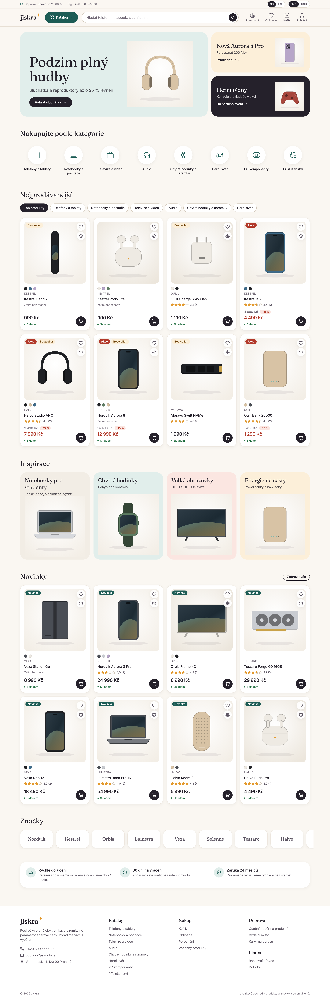
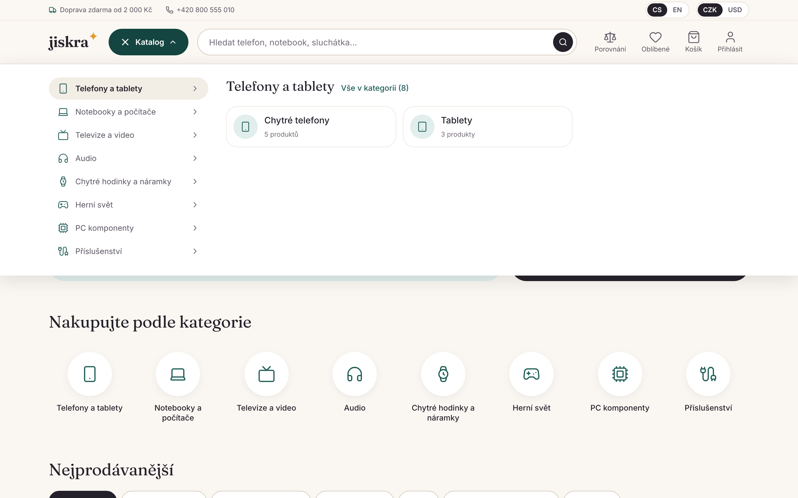
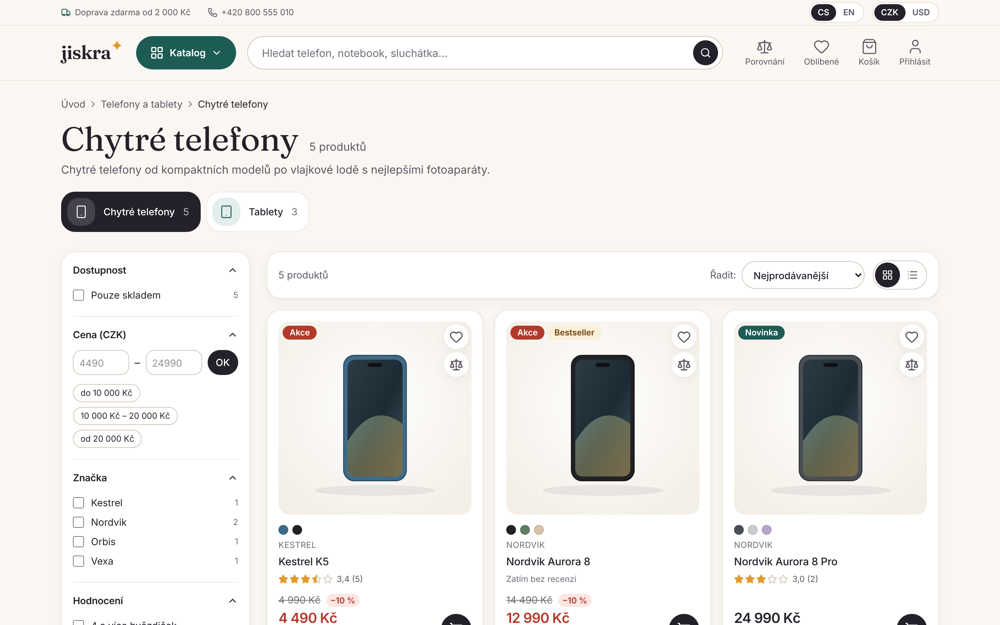
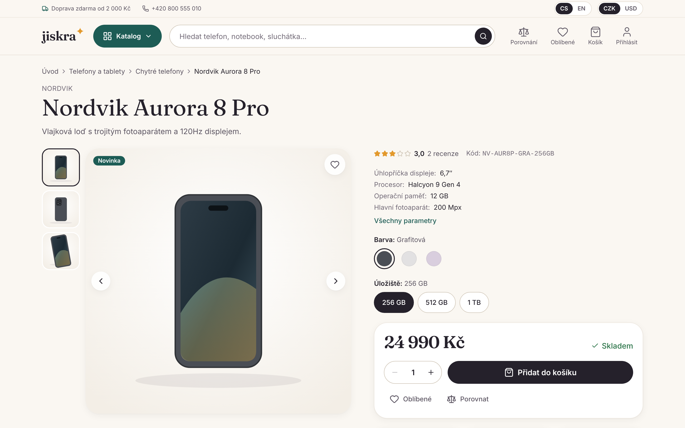
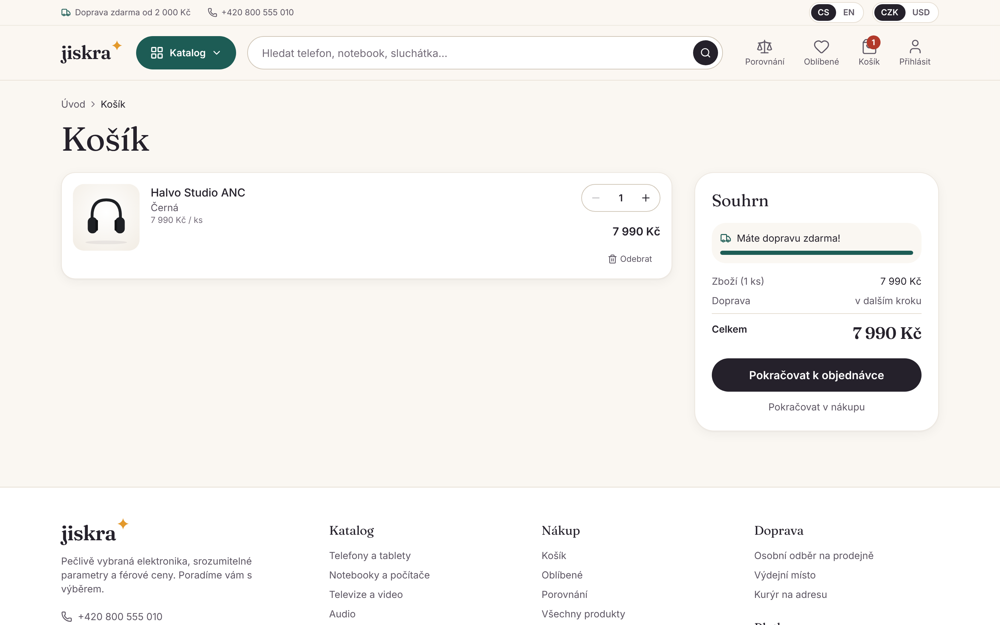
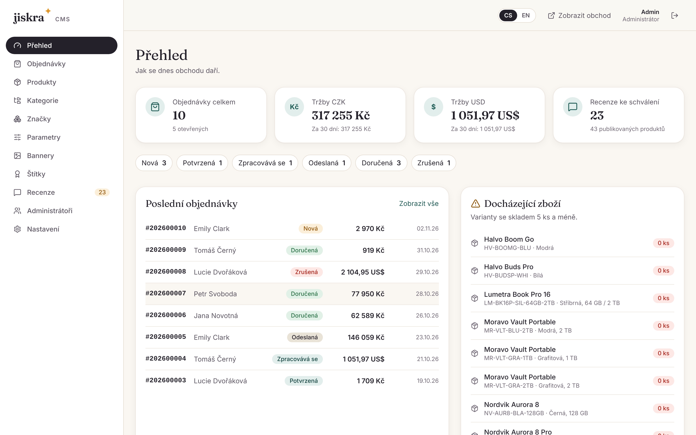

# Jiskra — electronics e-shop with a built-in CMS

Self-written online store for consumer electronics with its own admin panel. No third-party CMS or
e-commerce engine. Czech (default) + English, CZK (default) + USD.

**Stack:** Next.js 15 (App Router) · TypeScript (strict) · Tailwind CSS 4 · Prisma 6 (SQLite in dev,
PostgreSQL-ready) · next-intl · Zod · Vitest · Playwright.

## Quick start

Requirements: Node.js 20+ and npm.

```bash
npm install
cp .env.example .env        # adjust SEED_ADMIN_* if you like
npm run db:push             # create the SQLite database (prisma/dev.db)
npm run db:seed             # demo catalogue + admin user
npm run dev                 # http://localhost:3000 → redirects to /cs
```

Then open http://localhost:3000/cs (storefront) and http://localhost:3000/admin (CMS).

The admin panel lives at `/admin` (credentials = `SEED_ADMIN_EMAIL` / `SEED_ADMIN_PASSWORD` from `.env`).

## Screenshots

| Home | Catalog menu | Category |
| --- | --- | --- |
|  |  |  |
| **Product** | **Cart** | **CMS dashboard** |
|  |  |  |

Mobile: [docs/screenshots/7-mobile.png](docs/screenshots/7-mobile.png)

## Scripts

| Command | What it does |
| --- | --- |
| `npm run dev` | Development server |
| `npm run build` / `npm start` | Production build / server |
| `npm run typecheck` | `tsc --noEmit` |
| `npm run lint` | ESLint |
| `npm test` | Vitest unit + integration tests (uses a throwaway `prisma/test.db`) |
| `npm run test:e2e` | Playwright e2e + axe accessibility tests (run `npm run build` first; uses its own `prisma/e2e.db` on port 3200) |
| `npm run check` | typecheck + lint + unit tests + build |
| `npm run db:reset` | Drop, recreate and reseed the dev database |
| `npm run db:backfill` | Fill derived columns (search text, spec keys, aggregates) after upgrading an existing database |

## Project layout

```
messages/<locale>/*.json   UI strings per namespace (cs, en)
prisma/                    schema + seed
src/app/[locale]/          storefront (localized)
src/app/admin/             CMS (not localized; UI language from cookie)
src/components/            UI, storefront and admin components
src/lib/                   domain logic (money, cart, filters, orders, payments, mailer, storage, auth)
src/i18n/                  next-intl routing and request config
```

See `PROGRESS.md` for the phase plan, decisions and current status.

## Production notes

- Switch `provider = "sqlite"` to `"postgresql"` in `prisma/schema.prisma` and set `DATABASE_URL`.
  The schema avoids SQLite-only features.
- Stripe is enabled only when `STRIPE_SECRET_KEY` is set (use test keys).
- E-mail: `MAILER=console` (default) | `smtp` (`SMTP_URL`) | `file` (`MAIL_OUTBOX`). Set `NEXT_PUBLIC_SITE_URL`
  so links in e-mails point to the right host.
- Uploads: `STORAGE=local` (default, `public/uploads`) | `s3` (AWS S3 / Cloudflare R2 / MinIO, see `.env.example`).
  Files are always served through `/uploads/...`.
- Customer accounts are optional; registration requires e-mail verification, so configure a real mailer in production.
